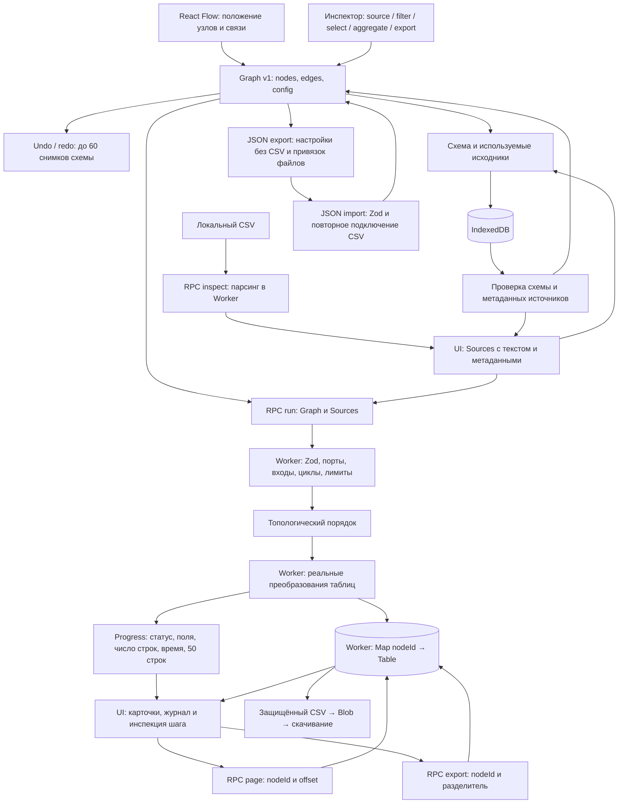

# Исполнение «Маршрута»

«Маршрут» превращает визуальную схему в повторяемую обработку локальных CSV. React Flow отвечает за графический редактор; значение схемы и правила вычисления определяет независимое табличное ядро. Схема сама по себе не содержит пользовательских исходников.

## Что гарантирует граф

Каждый порт переносит таблицу: имена столбцов, строки и типы. У источника нет входа, у выгрузки нет выхода, остальные шаги принимают ровно одну таблицу. Выход можно разветвлять. `validateGraph` отклоняет повреждённые ссылки, повторные связи, второй вход и циклы. `canConnect` проверяет новое соединение ещё в редакторе; Worker повторяет проверку перед запуском. Объединение таблиц не маскируется несколькими входами — такого оператора пока нет.

Исполнитель обходит DAG в топологическом порядке. Источник читает настоящий CSV; фильтр отбирает строки, select создаёт проекцию, aggregate собирает группы и метрики. Карта результатов принадлежит Worker. UI получает небольшие previews и запрашивает следующие страницы отдельно. Скачать можно любую успешную промежуточную таблицу.

Ошибка шага не создаёт фиктивную таблицу: потомки получают статус `skipped`, независимая ветка продолжает вычисляться. Настройки и имена входных полей проверяются на фактической таблице. После смыслового изменения схемы интерфейс очищает результаты, чтобы экспорт не выглядел актуальным для уже изменённых условий. Простое перемещение карточки вычисление не меняет.

## Компромиссы предметной модели

- **Полный повторный запуск вместо инкрементального кэша.** Источники снова парсятся, шаги выполняются заново. Поведение проще объяснить и проверить, отсутствует проблема неполной инвалидации кэша. Цена — повторная работа. Для кэширования понадобятся содержимое источника, конфигурация узла и версии upstream в ключе.
- **Все промежуточные таблицы сохраняются до следующего запуска.** Это даёт прозрачную инспекцию и выгрузку каждого шага, но увеличивает расход памяти на длинных маршрутах и ветках. Ограничения: до 40 узлов, 120 связей и 50 МБ исходников. Streaming и очистка ненужных результатов потребуют другого контракта инспекции.
- **История версионирует схему, а не CSV.** Undo удобен для соединений и настроек, но не обещает восстановить содержимое заменённого файла. JSON переносит операции; IndexedDB дополнительно хранит используемые исходники. Это разные способы переноса и восстановления.
- **Некорректные числа требуют явной политики.** Группировка либо останавливает шаг, либо пропускает значения с предупреждением. Пустые значения исключаются из числовых метрик; `count(*)` и `count(column)` имеют разную семантику. Переполнение вызывает ошибку, точная decimal-арифметика не заявляется.
- **Исполняются только известные операции.** Здесь нет `eval`, пользовательского JavaScript и сетевых шагов. Этот предел удерживает сериализуемость схемы и локальность данных; новый тип операции потребует расширить схему, форму настройки и исполнитель вместе.

Тесты проверяют структуру DAG, преобразования, точные итоги рабочего примера, независимые ветки при ошибках и RPC. Протокольный тест подставляет `self`; настоящий браузерный Worker и пользовательские сценарии проверяются отдельно.

## Вопросы для интервью

1. После изменения одного фильтра какие результаты можно переиспользовать, а какие надо сбросить? Предложите ключ кэша и разберите изменение CSV при сохранении прежнего имени файла.
2. Как добавить join двух CSV, сохранив понятную проверку портов, ограничение памяти и возможность показать ошибку на конкретном узле? Какие новые правила нужны для ключей, дубликатов и типов?
