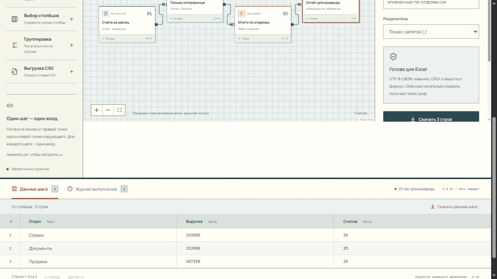

# Маршрут


Загрузите CSV, соедините операции отбора и группировки, проверьте промежуточные таблицы и скачайте отчёт. **«Маршрут» 0.1.0-rc.1** исполняет эту схему локально: карточки на холсте соответствуют настоящим преобразованиям данных.

Инструмент подходит для повторяющихся разборов выгрузок: например, отобрать оплаченные счета и собрать итоги по отделам. Пользователь сохраняет правила обработки в JSON, а при следующем запуске подключает новый файл. Сервер, аккаунт и написание скрипта для такого сценария не требуются.

[Архитектура: DAG, исполнитель, инспекция и сохранение](./ARCHITECTURE.md).

## Запуск

В каталоге проекта нужны npm и Node.js 24.x либо поддерживаемая версия 22.x, начиная с 22.12. Локальные проверки выполнены на Node.js 24.

```sh
npm ci
npm run dev
```

Откройте [127.0.0.1:4312](http://127.0.0.1:4312). Порт и адрес настроены в проекте; переменные окружения и внешние службы не нужны.

Собранное приложение можно проверить отдельно:

```sh
npm run build
npm start
```

`npm start` вызывает `vite preview` на порту 4312. Dev-сервер и просмотр сборки одновременно на этом порту не работают. Для статического хостинга используется `dist/`; preview-сервер предназначен для локального просмотра.

## Демо за две минуты

1. Открыть приложение: готовый маршрут «Оплаченные счета по отделам» содержит 96 синтетических счетов. Это явно помеченный встроенный пример.
2. Нажать «Запустить». Источник прочитает 96 строк, фильтр оставит 76 оплаченных, группировка посчитает выручку и число счетов по трём отделам.
3. Нажать любой шаг и посмотреть его реальные данные, размеры, время и журнал.
4. В узле выгрузки скачать готовый CSV. Сменить фильтр, выполнить снова и увидеть другой результат.
5. Выбрать источник и заменить пример собственным CSV. Настроить имена столбцов в фильтре/группировке. Или начать «Новый» маршрут и добавить шаги из библиотеки.

Сохраните схему кнопкой «Схема» и импортируйте JSON обратно. Источники потребуется подключить заново: файл схемы переносит операции, а не пользовательские документы. После восстановления из IndexedDB исходники остаются на месте, но вычисление всё равно запускается явно.



## Стек и границы ответственности

Интерфейс написан на React 19 и TypeScript; холст — `@xyflow/react` (React Flow 12). Zod 4 проверяет формат схемы, Papa Parse читает CSV. Исполнитель работает в Web Worker, локальное сохранение — IndexedDB через `idb-keyval`. Сборка: Vite 7; тесты: Vitest 5; форматирование: Prettier. Manrope, IBM Plex Mono и иконки Lucide поставляются вместе с приложением.

React Flow управляет отображением графа. Допустимость связей, порядок вычисления и результат каждой операции определяет собственное табличное ядро. Внешний backend отсутствует.

## Встроенные операции

| Шаг            | Поведение                                                                                                                                          |
| -------------- | -------------------------------------------------------------------------------------------------------------------------------------------------- |
| Источник CSV   | UTF-8 / Windows-1251; авто или заданный разделитель; кавычки, переносы строк и Unicode; заголовки первой записи                                    |
| Фильтр строк   | содержит / равно / больше / меньше / пусто / не пусто; явный тип сравнения: текст, число, ISO date; несколько фильтров соединяются последовательно |
| Выбор столбцов | проекция и порядок по последовательности выбора; отсутствие полей вызывает понятную ошибку                                                         |
| Группировка    | несколько ключей; count(*), count(column), sum, avg, min, max; до 20 метрик с пользовательскими именами; явная политика некорректных чисел         |
| Выгрузка CSV   | UTF-8 BOM, CRLF, кавычки, настраиваемый разделитель/имя; защита формул апострофом                                                                  |

Все операции работают в Web Worker. UI получает результаты и первые 50 строк каждого шага; следующие страницы запрашивает отдельно. Полные таблицы остаются в Worker до следующего запуска или отмены. Выгрузить можно данные любого успешного шага.

## Редактор и сохранение

- Перемещение узлов, масштабирование и выбор — React Flow. Для каждого шага один вход; выход можно разветвлять. Источник не принимает вход, выгрузка не имеет выхода. Self-links, циклы, повторные связи и второй вход отклоняются.
- Связи доступны также через выпадающий список «Входная таблица» в инспекторе, поэтому настройка схемы не требует точного перетаскивания мышью. Узлы добавляются кнопками.
- Undo/redo до 60 снимков схемы в текущей вкладке. Ctrl+Z / Ctrl+Shift+Z; Ctrl+Enter выполняет маршрут. История нативных текстовых полей не перехватывается. Перемещение записывается одним действием после drag.
- JSON экспорт содержит только схему и настройки. Ссылки на локальные файлы очищаются; CSV в JSON не попадает. Импорт валидируется Zod, после импорта источники нужно подключить заново. Неизвестные операции/версии и недопустимые координаты отклоняются. Настройки столбцов проверяются при выполнении относительно входной таблицы.
- IndexedDB автоматически сохраняет текущую схему и используемые CSV. После перезагрузки данные восстанавливаются, но маршрут автоматически не запускается. Ошибка/квота хранилища показывается в статусе.
- Изменение схемы/настроек очищает результаты, чтобы нельзя было скачать результат устаревшей конфигурации. Перемещение карточки не меняет вычисление. Отмена физически завершает Worker; исходники и схема остаются.
- Ошибка шага видна в журнале и инспекции; зависимая ветка помечается пропущенной, независимые ветки продолжают работать. Пользовательский код не исполняется, сетевых коннекторов нет.
- Самостоятельная визуальная система: графитовая панель, линейная сетка холста, контрастные связи и квадратные порты. Оранжевый акцент выделяет действие и выбранный узел; типы и результаты дополнительно обозначены текстом и иконками. Внешних CDN во время работы нет.

## Проверки

```sh
npm test
npm run build
npm run format:check
```

`npm test` проверяет импорт схем, циклы/порты/ветвление, типизированный отбор, порядок проекции, несколько метрик и ключей, пустые/некорректные значения, точные итоги встроенного примера, независимые ветки при ошибках, отсутствующие исходники, CSV с quoted newline/Unicode, защиту формул и протокол Worker (progress/page/export/сброс старых результатов). `npm run build` включает строгую TypeScript проверку и production сборку.

Тест протокола использует изолированную подстановку `self`; он проверяет обработчики сообщений, а не настоящий браузерный поток. Сквозной браузерный сценарий проверяется отдельно. Время в интерфейсе — фактическое `performance.now()` текущего выполнения; замеры на одном устройстве не являются обещанием производительности на других.

## Архитектура

- `src/pipeline.ts` — схема конфигураций, проверки графа, топологическая сортировка и чистые табличные преобразования.
- `src/table.ts` — CSV, разбор чисел/дат и безопасная сериализация; собственное независимое ядро проекта с Papa Parse.
- `src/pipeline.worker.ts` — хранение результатов исполнения, события прогресса, постраничная инспекция и экспорт.
- `src/worker-client.ts` — RPC/отмена. `src/App.tsx` — графический редактор, формы, история, IndexedDB. `src/example.ts` — воспроизводимый пример.

Полный повторный запуск выбран вместо инкрементального кэша: так результат не зависит от скрытого состояния предыдущего прогона. Сохранение всех промежуточных таблиц упрощает проверку каждого шага, но увеличивает расход памяти. [ARCHITECTURE.md](ARCHITECTURE.md) содержит схему исполнения, правила DAG и разбор этих компромиссов.

## Честные границы

- До 40 шагов, 120 связей, 50 МБ UTF-8 на все используемые источники; в CSV — до 500 000 строк, 200 столбцов и 5 млн ячеек. Все исходники/результаты находятся в памяти; много веток и преобразований увеличивает её расход. Streaming, огромные выгрузки и дисковое промежуточное хранение не реализованы.
- CSV с короткими записями дополняется пустыми ячейками с уведомлением; лишние поля и сломанные кавычки вызывают ошибку. Авторазделитель выбирается по первой непустой записи; при неоднозначности задайте вручную. Имена повторных/пустых заголовков нормализуются.
- JavaScript `number`, не decimal/bigint. Точная финансовая арифметика не заявляется; числовое переполнение вызывает ошибку агрегации. Для группировок используются исходные строки, а не нормализация регистра/форматов. Числа: точка или запятая, пробелы допустимы; смешанные локальные разделители не распознаются. Даты — ISO 8601.
- Пустые числа пропускаются в sum/avg/min/max; если числовых значений нет, результат пустой. Для некорректных чисел можно явно выбрать ошибку или пропуск с предупреждением. count(*) считает строки, count(column) — непустые значения. Число пропусков в предупреждении считается по метрикам, поэтому одна плохая ячейка в нескольких метриках может учитываться несколько раз.
- Экспорт защищает formula-like значения и заголовки апострофом, включая отрицательные числа. Это намеренное изменение значений; исходные CSV не переписываются.
- JSON переносит операции, но не исходные файлы. В истории версионируется схема, **не содержимое файлов**. Undo после замены файла с тем же идентификатором не восстанавливает прошлый CSV. История не переживает перезагрузку страницы.
- IndexedDB не зашифрована. На общем устройстве удаляйте сохранённую копию и закрывайте вкладку; очистка браузера может удалить набор. При следующем изменении проекта автосохранение снова создаёт копию. Отдельные версии проектов и аккаунты отсутствуют.
- Нет объединения таблиц, вычисляемых формул, произвольного кода, планировщика или серверных задач. Вся обработка выполняется по кнопке в текущей вкладке.
- Полный аудит WCAG, проверка всеми screen reader, мобильный drag-and-drop и production нагрузочное тестирование не заявляются. Для мобильного сценария доступны кнопки и выбор входа в форме.

## Источники дизайна

Для библиотеки операций изучен [Branching Tree Nav автора arunachalam из 21st.dev](https://21st.dev/@arunachalam/components/branching-tree-nav), для цветовых направлений — тема Orange Vivid. Чертёжная компоновка, карточки и формы сделаны под этот продукт. Источники, включая студийные референсы, и границы их использования описаны в [DESIGN_PROVENANCE.md](DESIGN_PROVENANCE.md).

Пример — синтетический; проект не содержит клиентских документов и не заявляет коммерческие метрики.

## Лицензия

В этой версии нет файла `LICENSE`; лицензия собственного исходного кода отдельно не объявлена. React Flow, остальные зависимости и шрифты имеют собственные лицензии; атрибуция React Flow на холсте сохранена.
